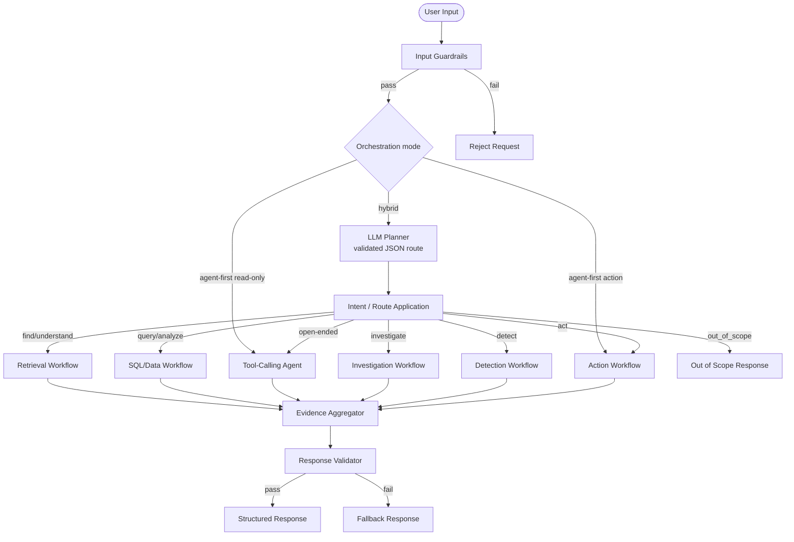
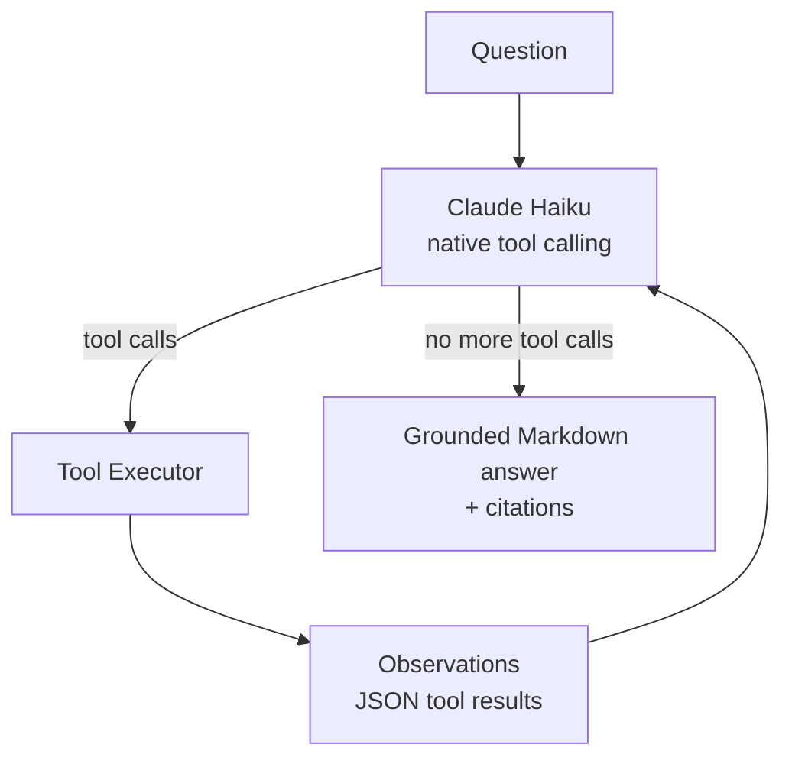

# Agent Architecture

## Overview

The platform supports two orchestration modes:

- **Agent-first (default):** all read-only questions go to the tool-calling
  agent. It chooses SQL, semantic metrics, documents, exceptions, and entity
  tools as needed. Deterministic guardrails and human-approved actions remain.
- **Hybrid:** a validated planner proposes a route; deterministic fast paths
  handle common operational questions, and the agent handles open-ended,
  exception-detail, policy, and multi-step analysis.

## Main Orchestrator Graph



The planner route is persisted in `planner_decisions` for audit. Deterministic
metric questions are protected by a semantic safety net, while comparative,
trend, and arbitrary data questions are routed to the agent.

## Agent State

```python
class AgentState(TypedDict):
    # Input
    user_input: str
    user_id: str
    session_id: str

    # Routing
    intent: str
    workflow: str

    # Evidence
    evidence: list[Evidence]
    citations: list[Citation]

    # Tool calls
    tool_calls: list[ToolCall]
    tool_results: list[ToolResult]

    # Action workflow
    action_request: ActionRequest | None
    approval_status: Literal["pending", "approved", "rejected", "not_required"]
    approval_decision: ApprovalDecision | None

    # Output
    response: str
    confidence: float
    errors: list[str]

    # Observability
    trace_id: str
    node_latencies: dict[str, float]
```

## Workflow Details

### Retrieval Workflow

- Query preprocessing (decompose, rewrite)
- Parallel BM25 + dense search
- Hybrid fusion (RRF)
- Cross-encoder reranking
- Context selection (token budget)
- LLM generation with evidence

### SQL Workflow

- Schema context injection
- LLM-based SQL generation
- Read-only SQL execution
- Result formatting
- Error handling with retry

### Open-Ended Agent Workflow



Tools:

| Tool | Purpose |
|---|---|
| `describe_schema` | Inspect public tables/columns without sensitive fields |
| `query_database` | One read-only `SELECT`/`WITH` query, max 100 rows |
| `run_metric` | Governed metric by name with allow-listed dimension/days |
| `search_documents` | Hybrid BM25 + dense document retrieval |
| `list_exceptions` | Curated anomaly records with invoice, PO, vendor, and contract context |
| `get_invoice`, `get_purchase_order`, `get_contract`, `get_vendor`, `get_payment`, `get_approval` | Specific entity lookups |

The model observes each result, can correct a failed query, and stops after at
most six tool-calling rounds. If the budget is exhausted, it must answer with
the evidence gathered and state any gaps.

### SQL Guardrails

The agent SQL tool is deliberately conservative:

- Single statement only; must start with `SELECT` or `WITH`.
- Data/schema-changing keywords, dangerous functions, row locking, and `SELECT INTO` are rejected.
- Sensitive tables (`planner_decisions`, LangGraph checkpoints) and columns
  (`password_hash`, `embedding`, `bank_details`) are blocked, including via `SELECT *`.
- Execution runs in a read-only transaction with a statement timeout.
- Results are capped at `SQL_MAX_ROWS` (default 100); the wrapper caps rows even
  when the query has its own `LIMIT`.
- Errors are sanitized and returned to the model so it can revise the query.
- Production should use a dedicated `SELECT`-only database role in addition to
  the application-level guard.

The agent does not receive action tools. Payments and approvals still require
the human-in-the-loop action workflow.

### Detection Workflow

The deterministic detection workflow remains available in hybrid mode. It runs
the invoice/PO/contract/payment rules directly. In agent-first mode, the agent
uses the curated `list_exceptions` tool and can then call `get_invoice`,
`query_database`, or other tools to enrich each affected record.

### Investigation Workflow

- Investigation planner (decompose into steps)
- Sequential tool execution
- Evidence comparison (deterministic rules)
- LLM explanation with citations

### Detection Workflow

- Deterministic rule evaluation
- ML anomaly detection (Isolation Forest)
- Policy verification
- Severity classification
- Evidence collection

### Action Workflow

- Request validation
- Policy check
- Risk assessment
- Human interrupt (if required)
- Action execution
- Audit logging

## Persistence

LangGraph uses PostgreSQL checkpointing via `langgraph.checkpoint.postgres`:
- Interrupted graph resumption
- Approval workflow persistence across restarts
- Time-travel debugging

Routing decisions are stored in `planner_decisions`. For agent runs, a compact
tool trace (tool name, arguments, row count, error) is attached to
`planner_decisions.raw_decision` for audit without storing full result sets.

## Error Handling

| Error Type | Handling |
|---|---|
| LLM timeout | Agent returns a clear failure message; planner has deterministic fallback |
| SQL syntax error | Error returned to the model, which can revise within the tool budget |
| Unsafe SQL | Rejected before execution; reason returned to the model |
| Tool failure | Logged; error returned to the model for an alternative approach |
| Tool budget exhausted | Model must answer with gathered evidence and state gaps |
| Database unavailable | Return "system unavailable" with retry guidance |
| Vector DB failure | Degrade to BM25-only retrieval |
| Hallucination detected | Reject response, request more evidence |
