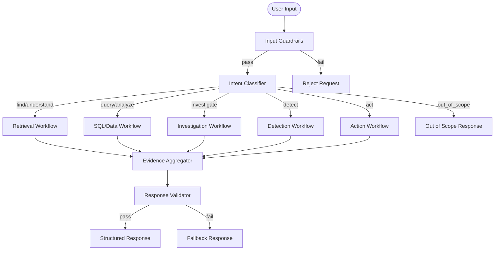

# Agent Architecture

## Overview

The agent system uses LangGraph for orchestration, with a main orchestrator graph that routes to specialized workflows based on intent classification.

## Main Orchestrator Graph



## Agent State

```python
class AgentState(TypedDict):
    # Input
    user_input: str
    user_id: str
    session_id: str

    # Routing
    intent: str
    workflow: str

    # Evidence
    evidence: list[Evidence]
    citations: list[Citation]

    # Tool calls
    tool_calls: list[ToolCall]
    tool_results: list[ToolResult]

    # Action workflow
    action_request: ActionRequest | None
    approval_status: Literal["pending", "approved", "rejected", "not_required"]
    approval_decision: ApprovalDecision | None

    # Output
    response: str
    confidence: float
    errors: list[str]

    # Observability
    trace_id: str
    node_latencies: dict[str, float]
```

## Workflow Details

### Retrieval Workflow

- Query preprocessing (decompose, rewrite)
- Parallel BM25 + dense search
- Hybrid fusion (RRF)
- Cross-encoder reranking
- Context selection (token budget)
- LLM generation with evidence

### SQL Workflow

- Schema context injection
- LLM-based SQL generation
- Read-only SQL execution
- Result formatting
- Error handling with retry

### Investigation Workflow

- Investigation planner (decompose into steps)
- Sequential tool execution
- Evidence comparison (deterministic rules)
- LLM explanation with citations

### Detection Workflow

- Deterministic rule evaluation
- ML anomaly detection (Isolation Forest)
- Policy verification
- Severity classification
- Evidence collection

### Action Workflow

- Request validation
- Policy check
- Risk assessment
- Human interrupt (if required)
- Action execution
- Audit logging

## Persistence

LangGraph uses PostgreSQL checkpointing via `langgraph.checkpoint.postgres`:
- Interrupted graph resumption
- Approval workflow persistence across restarts
- Time-travel debugging

## Error Handling

| Error Type | Handling |
|---|---|
| LLM timeout | Retry with backoff (max 2), then fallback |
| SQL syntax error | LLM regenerates SQL (max 2 retries) |
| Tool failure | Log, return error to LLM for alternative |
| Database unavailable | Return "system unavailable" with retry guidance |
| Vector DB failure | Degrade to BM25-only retrieval |
| Hallucination detected | Reject response, request more evidence |
